# Auth Flow Plan — SwiftPY Website

> Derived from [`auth_implementation_plan.md`](./auth_implementation_plan.md)

---

## Overview

This document visualizes every authentication flow as step-by-step sequences and decision diagrams. Use it alongside the implementation plan as a living reference during development and code review.

---

## 1. App Boot — Session Initialization

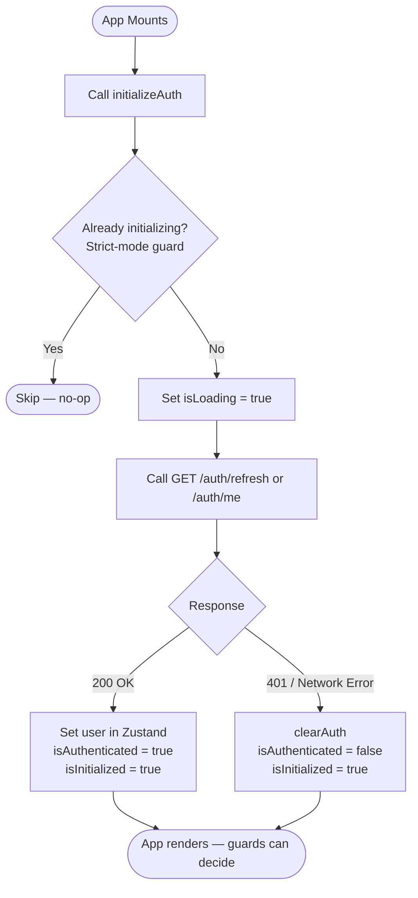

> [!IMPORTANT]
> `isInitialized` must be `true` before any guard makes a redirect decision. Guards render a neutral loading UI while `isInitialized === false`.

---

## 2. Login Flow

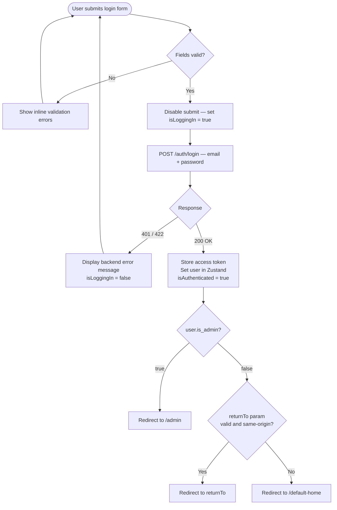

> [!NOTE]
> `is_admin` is read from the backend-verified user object — never from a form field, query parameter, or client guess.

---

## 3. Register Flow

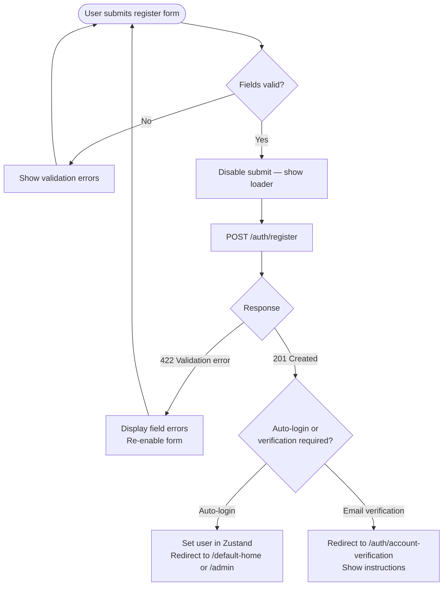

---

## 4. Forgot Password Flow

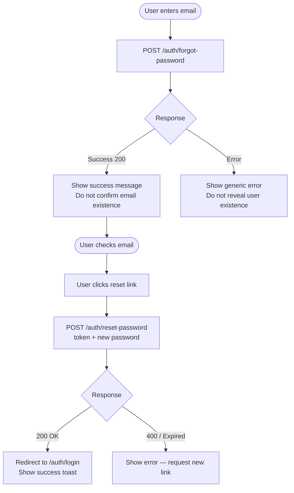

---

## 5. Account Verification Flow

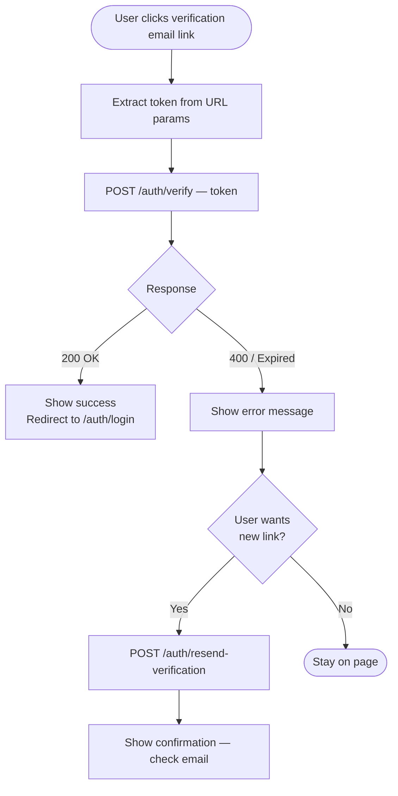

---

## 6. Token Refresh & 401 Interceptor (Single-Flight)

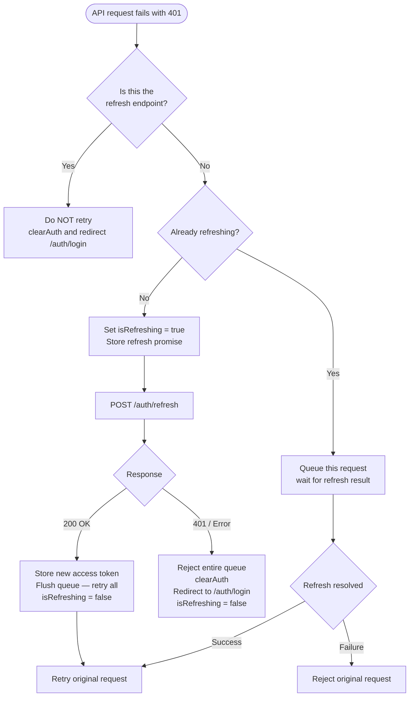

> [!CAUTION]
> Never retry a request more than once after a 401. Mark retried requests with `_retry = true` to prevent infinite loops.

---

## 7. Logout Flow

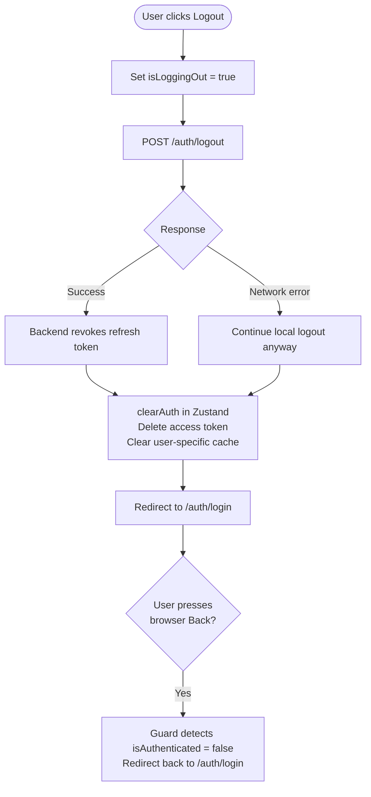

> [!WARNING]
> Even if the backend logout call fails, the frontend MUST clear all local auth state. Never leave a user appearing authenticated after they initiate logout.

---

## 8. GuestGuard — Auth Page Protection

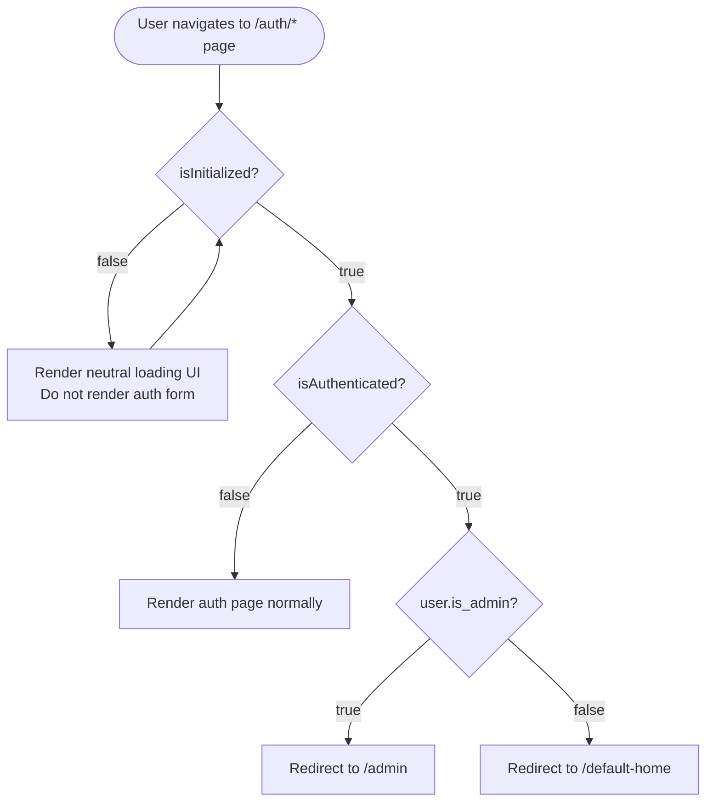

**Pages covered by GuestGuard:**
- `/auth/login`
- `/auth/register`
- `/auth/forgot-password`
- `/auth/account-verification`
- `/auth/reset-password`
- `/auth/resend-verification`

> [!IMPORTANT]
> The auth form must **never flash** before a redirect. The guard must hold render until `isInitialized === true`.

---

## 9. AuthGuard / AdminGuard — Admin Route Protection

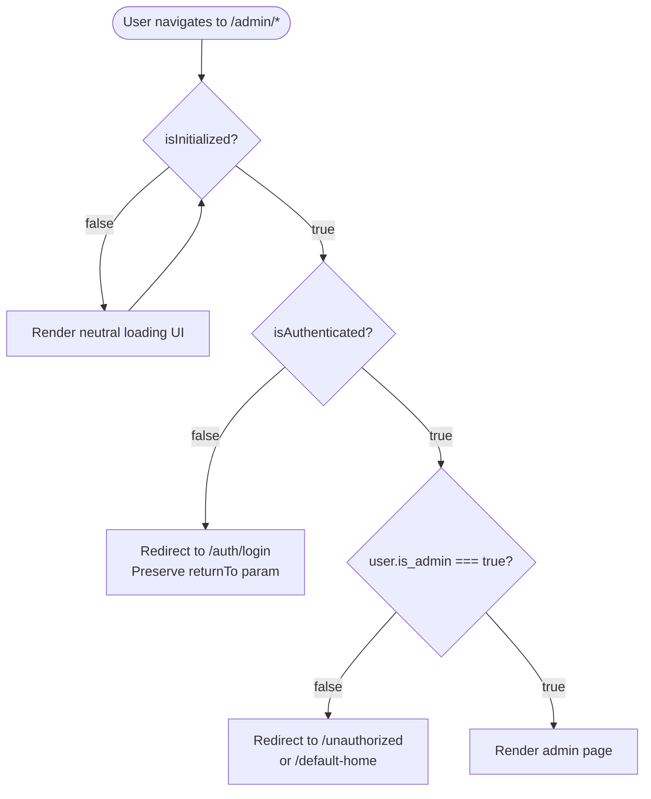

**Admin routes covered:**
- `/admin` (dashboard)
- `/admin/docs`
- `/admin/settings`
- `/admin/api`
- All nested `/admin/**` routes

---

## 10. returnTo Redirect Handling

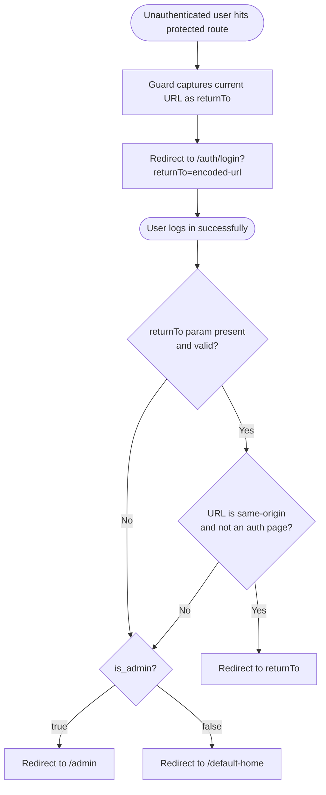

> [!CAUTION]
> Always validate `returnTo` to prevent open redirects. Only allow same-origin paths. Reject any URL starting with `http://`, `https://`, or `//`.

---

## 11. Zustand Auth Store — State Machine

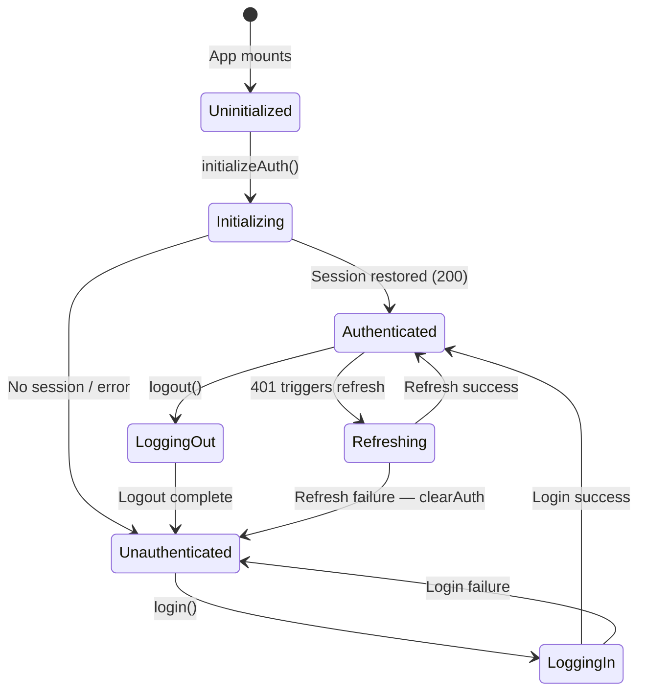

---

## 12. Component & Layer Dependency Map

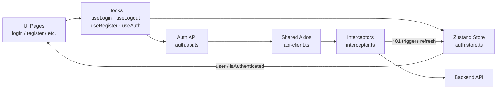

---

## 13. Guards & Layout Hierarchy

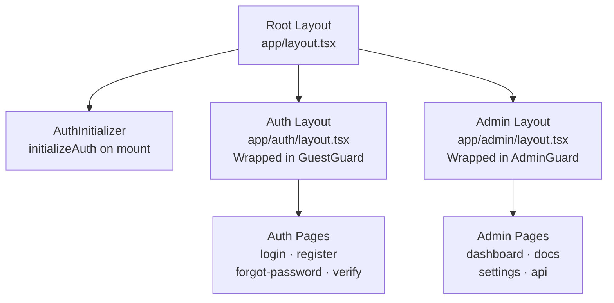

---

## 14. Test Scenario Checklist

| # | Scenario | Expected Result | Phase |
|---|----------|----------------|-------|
| 1 | Valid login — non-admin | Redirect to default home | 7 |
| 2 | Valid login — admin | Redirect to `/admin` | 7 |
| 3 | Invalid credentials | Show error, no redirect | 7 |
| 4 | Duplicate submit | Second submit blocked | 7 |
| 5 | Authenticated user visits `/auth/login` | Redirect away, no form flash | 5 |
| 6 | Authenticated user visits `/auth/register` | Redirect away | 5 |
| 7 | Unauthenticated user visits `/admin` | Redirect to login with `returnTo` | 6 |
| 8 | Non-admin visits `/admin` | Redirect to unauthorized | 6 |
| 9 | Admin visits `/admin/settings` directly | Access granted | 6 |
| 10 | Expired access token mid-session | Refresh triggered, request retried | 2 |
| 11 | Two concurrent 401s | Only one refresh request fired | 2 |
| 12 | Refresh token expired | clearAuth → redirect to login | 2 |
| 13 | Logout — API available | Backend revokes token, state cleared | 7 |
| 14 | Logout — API down | State cleared anyway, redirect to login | 7 |
| 15 | Page reload while authenticated | Session restored via refresh endpoint | 4 |
| 16 | Page reload while unauthenticated | Clean unauthenticated state | 4 |
| 17 | Register with duplicate email | Backend 422 displayed | 7 |
| 18 | Verification link expired | Show error + resend option | — |
| 19 | Open redirect via `returnTo` | Blocked — safe default used | 7 |
| 20 | No TypeScript/lint errors | Build passes | 8 |

---

## 15. Implementation Phase Summary

| Phase | Deliverable | Key Files |
|-------|------------|-----------|
| **1** | Inspect & findings report | _(read-only)_ |
| **2** | Axios + interceptors + single-flight refresh | `api/api-client.ts`, `api/interceptor.ts` |
| **3** | Zustand auth store | `auth/stores/auth.store.ts` |
| **4** | Session restoration on boot | `auth/stores/auth.store.ts` → `initializeAuth` |
| **5** | GuestGuard | `auth/components/GuestGuard.tsx`, `auth/layout.tsx` |
| **6** | AdminGuard | `auth/components/AuthGuard.tsx`, `admin/layout.tsx` |
| **7** | Login · Logout UI wired | `auth/hooks/useLogin.ts`, `useLogout.ts`, login page |
| **8** | Regression & security testing | All flows |
