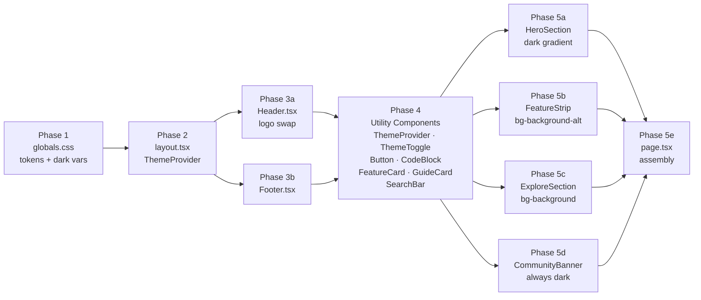

# SwiftPY Homepage — Frontend Implementation Plan

> [!IMPORTANT]
> This plan covers only the **homepage frontend** implementation.
> Stack: **Next.js 16 · React 19 · Tailwind CSS v4 · TypeScript**
> Dark mode is a **first-class requirement** throughout every phase — handled via the `dark` class strategy on `<html>`.

---

## Reference Design

The homepage mirrors the following layout (see attached design image):

```
┌─────────────────────────────────────────────────────────────┐
│  HEADER  (Logo · Search · Nav Links · GitHub · Theme · CTA) │
├─────────────────────────────────────────────────────────────┤
│  HERO SECTION                                               │
│    Left: Logo mark + "SwiftPY" headline + sub-heading +     │
│          "Get Started" & "Read the Docs" CTA buttons        │
│    Right: Animated code block / syntax-highlighted snippet  │
├─────────────────────────────────────────────────────────────┤
│  FEATURE STRIP  (4 icon-cards: Fast · Full-Stack ·          │
│                  Extensible · Secure)                       │
├─────────────────────────────────────────────────────────────┤
│  EXPLORE SECTION  (heading + "View all guides →" link +     │
│                    4 guide-cards)                           │
├─────────────────────────────────────────────────────────────┤
│  COMMUNITY BANNER  (dark gradient bg · logo · text · CTA)   │
├─────────────────────────────────────────────────────────────┤
│  FOOTER  (copyright · doc links · tagline)                  │
└─────────────────────────────────────────────────────────────┘
```

---

## Phase 1 — Design Tokens & Global Styles

**File:** `frontend/app/globals.css`

### 1.1 Dark Mode Strategy

Tailwind v4 is configured to use **class-based dark mode** (`dark` class on `<html>`).
This gives `ThemeToggle` full manual control independent of the OS preference.

```css
/* Opt into class-based dark mode in Tailwind v4 */
@import "tailwindcss";
@variant dark (&:where(.dark, .dark *));
```

### 1.2 Design Tokens — Light & Dark

Define all semantic tokens twice: once for light mode under `:root`, and once
overridden under `.dark`. Brand colours (`primary`, `secondary`, `accent`) stay
constant in both modes — only surface and text colours shift.

```css
/* frontend/app/globals.css */
@import "tailwindcss";
@variant dark (&:where(.dark, .dark *));

/* ── Light mode (default) ── */
:root {
  --primary:        #e10a06;
  --secondary:      #fc7107;
  --accent:         #0abd22;

  --foreground:     #0d132c;
  --foreground-muted: #0d132c99;      /* ~60% opacity */

  --background:     #fdfdfe;
  --background-alt: #f4f4f6;         /* section stripes, card fills */

  --border:         #0d132c1a;       /* ~10% foreground */
  --surface:        #ffffff;         /* card / input backgrounds */
}

/* ── Dark mode overrides ── */
.dark {
  --foreground:       #e8eaf2;
  --foreground-muted: #e8eaf299;

  --background:       #0d1117;
  --background-alt:   #161b22;

  --border:           #ffffff1a;
  --surface:          #1c2230;
}

@theme inline {
  /* Brand (unchanged in both modes) */
  --color-primary:          var(--primary);
  --color-secondary:        var(--secondary);
  --color-accent:           var(--accent);

  /* Semantic surface tokens */
  --color-foreground:       var(--foreground);
  --color-foreground-muted: var(--foreground-muted);
  --color-background:       var(--background);
  --color-background-alt:   var(--background-alt);
  --color-border:           var(--border);
  --color-surface:          var(--surface);

  /* Typography */
  --font-sans: var(--font-geist-sans);
  --font-mono: var(--font-geist-mono);
}

body {
  background-color: var(--background);
  color: var(--foreground);
  transition: background-color 0.2s ease, color 0.2s ease;
}
```

> [!NOTE]
> Tailwind v4 tokens registered in `@theme inline` are immediately available as
> utility classes: `bg-primary`, `text-secondary`, `bg-surface`, `border-border`, etc.
> No `tailwind.config.*` file is needed.

> [!TIP]
> Use the **semantic** tokens (`bg-background`, `bg-surface`, `text-foreground-muted`,
> `border-border`) everywhere in components — **never** raw Tailwind grays like
> `bg-gray-100`. This ensures dark mode works automatically with zero extra `dark:` classes.

---

## Phase 2 — Root Layout

**File:** `frontend/app/layout.tsx`

### 2.1 Update Metadata

```tsx
export const metadata: Metadata = {
  title: "SwiftPY — The Modern Python Framework for Builders",
  description:
    "Fast. Powerful. Developer-Friendly. Build modern applications with confidence using SwiftPY.",
};
```

### 2.2 Compose Header + Footer into Layout

Import the existing layout components and wrap `{children}` between them.
Add `suppressHydrationWarning` on `<html>` to silence the mismatch caused by
`ThemeProvider` writing the `dark` class before React hydrates.

```tsx
import Header from "./layouts/Header";
import Footer from "./layouts/Footer";
import ThemeProvider from "./components/utils/ThemeProvider";

export default function RootLayout({ children }: LayoutProps<"/">) {
  return (
    <html
      lang="en"
      className={`${geistSans.variable} ${geistMono.variable} h-full antialiased`}
      suppressHydrationWarning   {/* ← prevents dark-class hydration mismatch */}
    >
      <body className="min-h-full flex flex-col bg-background text-foreground">
        <ThemeProvider>
          <Header />
          <main className="flex-1">{children}</main>
          <Footer />
        </ThemeProvider>
      </body>
    </html>
  );
}
```

---

## Phase 3 — Layout Components

### 3.1 Header — `frontend/app/layouts/Header.tsx`

**Responsibility:** Top navigation bar, sticky on scroll.

| Region | Elements |
|---|---|
| **Left** | SwiftPY logo (light: `/logos/red-black.png`, dark: `/logos/red-white.png`) linking to `/` |
| **Centre** | Search bar with keyboard shortcut badge `Ctrl+K` |
| **Right-nav** | Links: `Guide` · `API Reference` · `Examples` · `Community` |
| **Right-actions** | GitHub icon button · `ThemeToggle` · `Get Started →` CTA button |

**Key implementation notes:**
- Use `"use client"` for the theme toggle and mobile menu state.
- Search bar: `<input>` with a magnifying-glass icon and a `<kbd>Ctrl+K</kbd>` hint.
- `Get Started` button: use the `Button` utility component (see Phase 4) with `variant="primary"`.
- Apply `sticky top-0 z-50 backdrop-blur bg-background/80` for the sticky blur — the semi-transparent background works in both light and dark automatically via the token.
- Logo swap: render both images with `<Image>` and show the correct one using `dark:hidden` / `dark:block` utility classes:
  ```tsx
  <Image src="/logos/red-black.png" … className="dark:hidden" />
  <Image src="/logos/red-white.png" … className="hidden dark:block" />
  ```
- Nav links: `text-foreground hover:text-primary` — readable in both modes.
- Border: `border-b border-border` — uses the semantic token that shifts automatically.

**Responsive behaviour:**
- Desktop (≥ lg): full layout as above.
- Mobile (< lg): collapse nav links into a hamburger menu; keep logo + CTA visible.

---

### 3.2 Footer — `frontend/app/layouts/Footer.tsx`

**Responsibility:** Site-wide footer.

| Region | Elements |
|---|---|
| **Left** | `© 2026 SwiftPY. All rights reserved.` |
| **Centre** | Links: `Documentation` · `GitHub` · `Community` · `License` |
| **Right** | `Made with ❤️ for Python Developers` |

**Key implementation notes:**
- `border-t border-border` — uses the semantic border token (auto dark).
- `bg-background text-foreground-muted` — no extra `dark:` classes needed.
- Link hover: `hover:text-primary`.

---

## Phase 4 — Reusable Utility Components

**Directory:** `frontend/app/components/utils/`

> [!NOTE]
> Components already in this directory (`Button`, `GradientButton`, `Modal`,
> `SideDrawer`) should be **updated** to use the new CSS token classes
> (`bg-primary`, `text-foreground`, `bg-surface`, `border-border`, etc.)
> rather than hard-coded hex or raw Tailwind gray values. This makes every
> component dark-mode-compatible without adding any `dark:` overrides.

### 4.1 `ThemeProvider.tsx` *(new — highest priority)*

A client-side context provider that:
1. Reads the saved preference from `localStorage` (`"theme": "light" | "dark"`).
2. Falls back to `prefers-color-scheme` on first visit.
3. Writes the `dark` class to `<html>` synchronously (via an inline `<script>` injected in `layout.tsx`) to avoid a flash of wrong theme (FOUT).
4. Exposes `{ theme, toggleTheme }` via `ThemeContext` to any child.

```tsx
// Inline script injected into <head> in layout.tsx to block FOUT
const themeScript = `
  (function() {
    var saved = localStorage.getItem('theme');
    var prefersDark = window.matchMedia('(prefers-color-scheme: dark)').matches;
    if (saved === 'dark' || (!saved && prefersDark)) {
      document.documentElement.classList.add('dark');
    }
  })();
`;
// In layout.tsx <head>:  <script dangerouslySetInnerHTML={{ __html: themeScript }} />
```

> [!CAUTION]
> Do **not** skip the inline script. Without it, the page will briefly flash
> the wrong theme on every hard refresh for users who have chosen dark mode.

---

### 4.2 `ThemeToggle.tsx` *(new)*

Sun/moon icon button, reads from and writes to `ThemeContext`.

- `"use client"` directive required.
- Shows a **sun** icon in dark mode (click → go light), **moon** icon in light mode (click → go dark).
- Animated icon crossfade with `transition-opacity duration-200`.

---

### 4.3 `Button.tsx` *(update)*

A polymorphic button accepting `variant`, `size`, `leftIcon`, and `rightIcon` props.

| Prop | Values | Notes |
|---|---|---|
| `variant` | `"primary"` `"outline"` `"ghost"` | Primary → `bg-primary text-white` (same in both modes) |
| `size` | `"sm"` `"md"` `"lg"` | Defaults to `"md"` |
| `leftIcon` | `React.ReactNode` | Icon before label |
| `rightIcon` | `React.ReactNode` | Icon after label (used for `→` arrows) |
| `as` | `"button"` \| `"a"` | Renders as `<a>` when `href` is supplied |

```tsx
// Minimal variant map — dark mode is handled by tokens, not extra dark: classes
const variants = {
  primary: "bg-primary hover:bg-primary/90 text-white rounded-full",
  outline: "border border-border hover:bg-background-alt text-foreground rounded-full",
  ghost:   "hover:bg-background-alt text-foreground rounded-full",
};
```

---

### 4.4 `CodeBlock.tsx` *(new)*

Syntax-highlighted code display used in the Hero section.

| Prop | Type | Description |
|---|---|---|
| `filename` | `string` | Tab label shown at the top of the block |
| `code` | `string` | Raw source code string |
| `language` | `string` | Language hint for highlight (default `"python"`) |

**Implementation notes:**
- Container: `bg-surface border border-border rounded-2xl` — adapts automatically.
- Chrome header: three coloured dots + filename centred + copy icon.
- Syntax token colours defined as CSS variables so they also shift in dark mode:

| Token | Light | Dark |
|---|---|---|
| Keyword | `text-secondary` | `text-secondary` (unchanged) |
| String | `text-accent` | `text-accent` (unchanged) |
| Identifier | `text-foreground` | `text-foreground` |
| Comment | `text-foreground-muted` | `text-foreground-muted` |
| Punctuation | `text-foreground/70` | `text-foreground/70` |

- Background of code area: `bg-surface` (white → dark card automatically).

---

### 4.5 `FeatureCard.tsx` *(new)*

Small card used in the Feature Strip.

| Prop | Type | Description |
|---|---|---|
| `icon` | `React.ReactNode` | Icon wrapped in a coloured circle |
| `title` | `string` | Bold short title |
| `description` | `string` | One-line supporting text |

Styling: `flex items-start gap-4 p-4 bg-background rounded-xl`.
Icon badge: `bg-primary/10 text-primary rounded-full p-2` — the `bg-primary/10` tint works well in both modes.

---

### 4.6 `GuideCard.tsx` *(new)*

Larger card used in the Explore section.

| Prop | Type | Description |
|---|---|---|
| `icon` | `React.ReactNode` | Coloured icon |
| `title` | `string` | Card heading |
| `description` | `string` | Short body text |
| `linkLabel` | `string` | Anchor text for the coloured link |
| `href` | `string` | Destination URL |
| `linkColor` | `"primary"` \| `"secondary"` \| `"accent"` | Controls link colour |

Styling: `rounded-2xl border border-border bg-surface p-6 hover:shadow-md transition-shadow`.
In dark mode: `bg-surface` becomes the dark card surface, `border-border` becomes a subtle white-tint border — no extra classes needed.

---

### 4.7 `SearchBar.tsx` *(new)*

Extracted from the Header for reuse.

| Prop | Type | Description |
|---|---|---|
| `placeholder` | `string` | Input placeholder |
| `shortcut` | `string` | Keyboard shortcut badge (e.g. `"Ctrl+K"`) |
| `onSearch` | `(q: string) => void` | Callback |

Styling: `bg-background-alt border border-border rounded-full text-foreground placeholder:text-foreground-muted` — fully token-driven, zero `dark:` overrides needed.

---

## Phase 5 — Homepage Page

**File:** `frontend/app/page.tsx`

This is a **React Server Component** (no `"use client"` at top level).
Import and compose the five sections below.

### 5.1 Section: `HeroSection`

```
[ SwiftPY logomark ]   SwiftPY
The Modern Python
Framework for Builders          [ CodeBlock: main.py ]
Fast. Powerful. Developer-Friendly.
[ Get Started → ]  [ Read the Docs ]
```

- **Left column** (60% width on desktop):
  - Logo swap via `dark:hidden` / `dark:block` (same technique as Header).
  - `<h1>` with the word **"Builders"** wrapped in `<span className="text-primary underline decoration-wavy">`.
  - Sub-headline `<p>` in `text-foreground-muted`.
  - Two `<Button>` components side by side.
- **Right column** (40% width on desktop):
  - `<CodeBlock filename="main.py" language="python" code={HERO_CODE_SNIPPET} />`
- Background:
  - **Dynamic Angled Geometric Artwork (`HeroBackground.tsx`):**
    - Saturated fiery orange-red diagonal wedge (`#fc7107` to `#e10a06`) across the top-right corner.
    - Translucent secondary speed angles and ambient glow radiating behind the code editor card.
    - Crisp luminous diagonal highlight edge beam.
    - Sleek dark cyber-ember variant in dark mode.

### 5.2 Section: `FeatureStrip`

Four `<FeatureCard>` components in a responsive grid (`grid-cols-2 lg:grid-cols-4`).
Section background: `bg-background-alt` — slightly off-white in light, slightly elevated dark in dark mode.

| Icon | Title | Description |
|---|---|---|
| ⚡ Lightning | **Blazing Fast** | Async-first architecture for peak performance. |
| 📦 Box | **Full-Stack Ready** | Web, database, events, queues and more out of the box. |
| 🧩 Puzzle | **Extensible** | A modular design for unlimited possibilities. |
| 🛡 Shield | **Secure by Design** | Built with security best practices. |

---

### 5.3 Section: `ExploreSection`

Header row: `<h2>Explore SwiftPY</h2>` + `<a>View all guides →</a>` (right-aligned, `text-primary`).

Four `<GuideCard>` components in a responsive grid (`grid-cols-1 sm:grid-cols-2 lg:grid-cols-4`).
Section background: `bg-background`.

| Icon | Title | Description | Link label | Color |
|---|---|---|---|---|
| 🚀 Rocket | **Get Started Quickly** | Install SwiftPY and create your first application in minutes. | Installation Guide → | `primary` |
| 📚 Stack | **Explore the Features** | Discover routing, ORM, events, queues and more. | Core Concepts → | `secondary` |
| 📖 Book | **Browse Examples** | See real-world examples and complete projects. | Examples → | `primary` |
| `< >` Code | **Dive into the API** | Get detailed API reference and advanced usage. | API Reference → | `secondary` |

---

### 5.4 Section: `CommunityBanner`

Full-width dark banner — intentionally dark in **both** light and dark mode (it is a branded accent section).

- Background: always `bg-foreground` (the dark navy defined in `:root`), with a mountain SVG/image overlay.
- Because this section is permanently dark, text inside it must always be light — use **local inline colour classes** (`text-white`, `text-white/80`) rather than the semantic tokens which invert in dark mode.
- **Left:** SwiftPY logo always uses `/logos/red-white.png` (white version — correct for a dark bg in both modes).
- **Right:** `<Button variant="secondary">Join Community →</Button>` (orange fill — always visible on dark).

> [!NOTE]
> This is the **one exception** to the semantic-token rule. Since the banner is
> unconditionally dark, hard-code `text-white` / `text-white/70` inside it.

---

### 5.5 Assembling `page.tsx`

```tsx
// frontend/app/page.tsx
import HeroSection      from "./components/home/HeroSection";
import FeatureStrip     from "./components/home/FeatureStrip";
import ExploreSection   from "./components/home/ExploreSection";
import CommunityBanner  from "./components/home/CommunityBanner";

export default function HomePage() {
  return (
    <>
      <HeroSection />
      <FeatureStrip />
      <ExploreSection />
      <CommunityBanner />
    </>
  );
}
```

> [!NOTE]
> Place the four home-specific section components under
> `frontend/app/components/home/` to keep them scoped to the homepage and
> away from the general-purpose `utils/` folder.

---

## Phase 6 — Asset Usage

| Logo file | Light mode usage | Dark mode usage |
|---|---|---|
| `red-black.png` | Header logo · Hero section logomark | Hidden (`dark:hidden`) |
| `red-white.png` | Community banner (always dark bg) | Header logo · Hero logomark (`dark:block`) |
| `black-bg.png`  | Reserved — marketing pages | Reserved |

> [!TIP]
> Always use Next.js `<Image>` with explicit `width`, `height`, and `priority`
> on above-the-fold images (Header logo, Hero logomark) to avoid LCP regressions.

---

## File Checklist

```
frontend/
├── app/
│   ├── globals.css                          ✏️  update  — color tokens + dark mode vars + @variant dark
│   ├── layout.tsx                           ✏️  update  — ThemeProvider + suppressHydrationWarning + metadata
│   ├── page.tsx                             ✏️  replace — compose homepage sections
│   ├── layouts/
│   │   ├── Header.tsx                       ✏️  build   — full nav bar + logo swap dark/light
│   │   └── Footer.tsx                       ✏️  build   — full footer (token-driven)
│   └── components/
│       ├── utils/
│       │   ├── Button.tsx                   ✏️  update  — variant/size/icon props + semantic token colours
│       │   ├── GradientButton.tsx           ✏️  update  — align to new tokens
│       │   ├── Modal.tsx                    ✏️  update  — bg-surface, border-border, text-foreground
│       │   ├── SideDrawer.tsx               ✏️  update  — bg-surface, border-border, text-foreground
│       │   ├── ThemeProvider.tsx            🆕  new     — context + FOUT-prevention inline script
│       │   ├── ThemeToggle.tsx              🆕  new     — sun/moon toggle, reads ThemeContext
│       │   ├── CodeBlock.tsx                🆕  new     — dark bg-surface, token syntax colours
│       │   ├── FeatureCard.tsx              🆕  new     — token-driven, no dark: overrides
│       │   ├── GuideCard.tsx                🆕  new     — bg-surface, border-border
│       │   └── SearchBar.tsx                🆕  new     — bg-background-alt, border-border
│       └── home/
│           ├── HeroSection.tsx              🆕  new     — logo swap, dynamic hero layout
│           ├── HeroBackground.tsx           🆕  new     — angled geometric fiery artwork matching design
│           ├── FeatureStrip.tsx             🆕  new     — bg-background-alt
│           ├── ExploreSection.tsx           🆕  new     — bg-background
│           └── CommunityBanner.tsx          🆕  new     — always dark; text-white hardcoded
└── public/
    └── logos/
        ├── red-black.png                   ✅  ready   — light mode surfaces
        ├── red-white.png                   ✅  ready   — dark mode surfaces + banner
        └── black-bg.png                    ✅  ready   — reserved
```

---

## Implementation Order



> [!TIP]
> Build and verify each phase in the browser (`npm run dev`) before moving to
> the next. Toggle dark mode after each phase to confirm the section looks
> correct in both themes before continuing.
